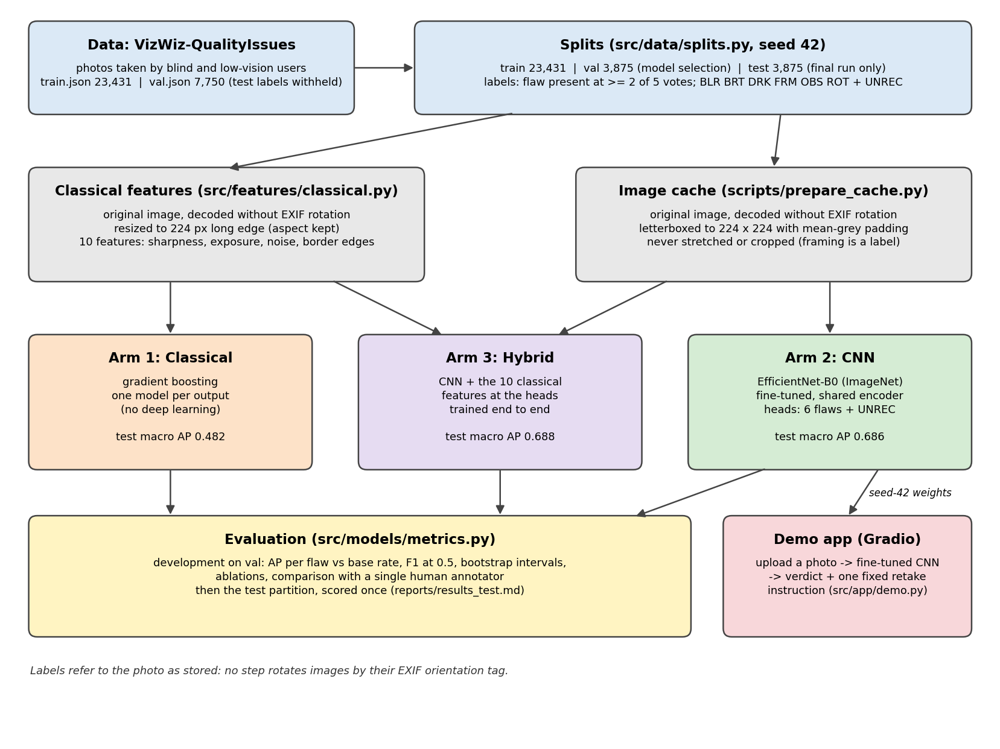

# mdsai-capstone-2026

## Actionable Image Quality Assessment for Assistive Photography

*A comparative study of classical, deep, and hybrid approaches*

Capstone project for Master in Data Science and AI, UoM. Predicts whether a photo taken by a
blind or low-vision (BLV) user is usable, and if not, which quality flaw is responsible (blur,
too dark, too bright, bad framing, obstruction, rotation), so a downstream recognition system can
ask for a corrective retake instead of returning a wrong answer. Three approaches are trained on
the same data and compared per flaw: a classical feature baseline (no deep learning), a
fine-tuned CNN, and a hybrid of the two.

## Key results

Final evaluation on the held-out test partition (3,875 images, never used for any decision during
development), run once. Average precision (AP) per output; the CNN and hybrid are the seed-42
entries. Full report: [reports/results_test.md](reports/results_test.md).

| Output | Type | Base rate | Classical | CNN | Hybrid |
|---|---|---|---|---|---|
| BLR (blurry) | photometric | 0.424 | 0.791 | 0.879 | 0.882 |
| DRK (too dark) | photometric | 0.060 | 0.587 | 0.645 | 0.641 |
| BRT (too bright) | photometric | 0.065 | 0.495 | 0.585 | 0.593 |
| FRM (badly framed) | semantic | 0.568 | 0.693 | 0.822 | 0.828 |
| OBS (obstructed) | semantic | 0.034 | 0.100 | 0.483 | 0.489 |
| ROT (rotated) | semantic | 0.171 | 0.223 | 0.702 | 0.696 |
| **Macro AP (6 flaws)** | | | **0.482** | **0.686** | **0.688** |
| UNREC (unrecognisable) | overall | | 0.746 | 0.808 | 0.808 |

- **The CNN beats the classical baseline on every output.** Macro AP +0.205 (95% paired bootstrap
  interval 0.184 to 0.223); every per-output interval excludes 0.
- **The gain is concentrated in the semantic flaws**, as hypothesised: classical features measure
  blur and exposure directly but cannot see framing, obstruction or rotation. Mean normalised gain
  over the base rate, classical vs CNN: photometric 0.552 vs 0.656, semantic 0.141 vs 0.564.
- **The hybrid is not distinguishable from the CNN** (macro +0.002, interval -0.004 to +0.008):
  adding handcrafted features to a fine-tuned CNN gives no measurable improvement.
- **ROT is learned from content, not image shape:** AP 0.644 on upright-stored photos (base rate
  0.144), where shape carries no signal.
- **Against a single human annotator** (one annotator's vote scored against the other four), the
  CNN is above on BLR and FRM, level on ROT, slightly below on DRK and OBS at the 0.5 threshold
  and 0.19-0.23 F1 above at its best threshold (val partition,
  [reports/results_human_ceiling.md](reports/results_human_ceiling.md)).

## Approach



| Arm | Input | Model |
|---|---|---|
| 1. Classical | Original image resized to a 224 px long edge | 10 handcrafted features (sharpness, exposure, noise, border edge energy) -> gradient boosting, one model per output |
| 2. CNN | 224 x 224 letterboxed image (padded, never stretched or cropped) | ImageNet-pretrained EfficientNet-B0, fine-tuned, shared encoder with two heads (6 flaws + unrecognisable), class-weighted BCE |
| 3. Hybrid | Both | The CNN with the 10 classical features added to its head inputs, trained end to end |

Every decision, with its evidence, is logged in [docs/decisions.md](docs/decisions.md).

## Dataset

**VizWiz-QualityIssues** (CC BY 4.0). Chiu, Zhao, Gurari, *"Assessing Image Quality Issues for
Real-World Problems"*, CVPR 2020. [arXiv:2003.12511](https://arxiv.org/abs/2003.12511).
Task page: https://vizwiz.org/tasks-and-datasets/image-quality-issues/

- Labels are votes from 5 crowdworkers per image. A flaw counts as present at **2 or more votes**,
  the dataset authors' definition (OTH and NON are not modelled).
- The official test labels are withheld, so the labelled data is 23,431 train + 7,750 val images.
  The val set is split 50/50 with seed 42 into **val** (3,875, model selection) and **test**
  (3,875, final evaluation only). Splits are defined once, in
  [src/data/splits.py](src/data/splits.py) ([reports/splits_report.md](reports/splits_report.md)).
- Images are never auto-rotated by their EXIF orientation tag: the ROT labels describe the photo as
  stored ([reports/exif_rotation_check.md](reports/exif_rotation_check.md)).

## Demonstration app

Upload a photo and get a usability verdict plus one plain-language retake instruction from the
fine-tuned CNN. Instructions come from a fixed phrase set (never generated text); a flaw counts as
detected at confidence 0.5; when several flaws are detected the main instruction follows a fixed
priority (dark, obstructed, bright, blurry, framing, rotated).

**Option 1: Google Colab (nothing to install)**
[](https://colab.research.google.com/github/ShenalPerera/mdsai-capstone-2026/blob/main/notebooks/07_demo.ipynb)
Runtime > Run all, then open the printed `https://....gradio.live` link (about 1 minute). Pip may
print dependency-conflict warnings about unrelated Colab packages; they do not affect the demo.

**Option 2: your own machine** (Python 3.10 to 3.12; a GPU is not needed)

```bash
git clone https://github.com/ShenalPerera/mdsai-capstone-2026.git
cd mdsai-capstone-2026
python3 -m venv venv && source venv/bin/activate     # Windows: venv\Scripts\activate
pip install -r requirements.txt                      # includes PyTorch: 1-6 GB, several minutes
curl -L -o best.pt "https://drive.usercontent.google.com/download?id=1km2PDHNhG-fONTdpUrSlonoM8DGqnSyM&export=download&confirm=t"
python scripts/run_demo.py --checkpoint best.pt      # open http://127.0.0.1:7860
```

The trained weights (`best.pt`, 16 MB) are not in the repository; without `curl`, download them in a
browser from [Google Drive](https://drive.google.com/file/d/1km2PDHNhG-fONTdpUrSlonoM8DGqnSyM/view?usp=sharing)
and save them as `best.pt` in the repository folder.

## Repository structure

```
.
├── docs/
│   ├── decisions.md            # every decision with its rationale and evidence
│   └── milestone1.md           # Milestone 1 proposal
├── notebooks/                  # analysis notebooks, committed with their outputs
│   ├── 01_eda.ipynb            # exploratory analysis          -> reports/eda.md
│   ├── 02_classical.ipynb      # Arm 1, classical baseline     -> reports/results_classical.md
│   ├── 03_cnn.ipynb            # Arm 2, CNN                    -> reports/results_cnn.md
│   ├── 04_hybrid.ipynb         # Arm 3, hybrid                 -> reports/results_hybrid.md
│   ├── 05_comparison.ipynb     # comparison and ablations      -> reports/results_comparison.md
│   ├── 06_human_ceiling.ipynb  # human annotator level         -> reports/results_human_ceiling.md
│   └── 07_demo.ipynb           # demonstration app (Colab)
├── reports/                    # every result as markdown (+ CSV), figures/
├── scripts/                    # command-line steps (data, cache, features, training, test, demo)
├── src/
│   ├── data/                   # splits, PyTorch dataset, letterbox cache
│   ├── eda/                    # label and image-property analysis, report writer
│   ├── features/classical.py   # handcrafted features
│   ├── models/                 # classical models, CNN, metrics, human-ceiling simulation
│   └── app/demo.py             # demo logic: preprocessing, prediction, fixed instructions
├── requirements.txt
└── README.md
```

Data, image caches and model weights are not committed (`data/` is gitignored).

## Reproducing the results

All runs used Google Colab (Tesla T4 GPU, 12.7 GB RAM), seed 42 for torch, numpy and random.
Every script takes the data directory as its first argument (`DATA` below) and writes its numbers
to `reports/` or `DATA/`. Notebooks read `DATA` from the `DATA_DIR` environment variable (default
`./data`) and import all logic from `src/`.

| Step | Command | Output |
|---|---|---|
| 1. Download data | `bash scripts/download_data.sh DATA` | images + annotations |
| 2. Check data | `python scripts/verify_json_integrity.py DATA`, `python scripts/verify_data.py DATA` | `reports/data_summary.md` |
| 3. Splits | `python scripts/report_splits.py DATA` | `reports/splits_report.md` |
| 4. EXIF check | `python scripts/check_exif_rotation.py DATA` | `reports/exif_rotation_check.md` |
| 5. Image properties | `python scripts/extract_image_properties.py DATA` | `DATA/image_properties.csv` |
| 6. EDA | `notebooks/01_eda.ipynb` | `reports/eda.md` |
| 7. Classical features | `python -u scripts/extract_classical_features.py DATA` (about 50 min) | `DATA/classical_features_{224,512}.csv` |
| 8. Arm 1 | `notebooks/02_classical.ipynb` | `reports/results_classical.md` |
| 9. Image cache | `python -u scripts/prepare_cache.py DATA` (about 25 min), `python scripts/verify_cache.py DATA` | `DATA/image_cache_224/` (tar shards), `reports/cache_verification.md` |
| 10. Unpack cache | `mkdir CACHE && for s in DATA/image_cache_224/shard_*.tar; do tar -xf "$s" -C CACHE; done` | flat folder of 27,306 JPEGs |
| 11. Arm 2 | `python -u scripts/train_cnn.py DATA --cache-dir CACHE --mode M` for M = `overfit` (pipeline check), `frozen`, `finetune` (about 8 min); then `notebooks/03_cnn.ipynb` | `DATA/cnn_runs/`, `reports/results_cnn.md` |
| 12. Arm 3 | `python -u scripts/train_cnn.py DATA --cache-dir CACHE --mode finetune --hybrid`; seeds 43, 44: `python -u scripts/train_cnn_seeds.py DATA --cache-dir CACHE`; then `notebooks/04_hybrid.ipynb` | `reports/results_hybrid.md` |
| 13. Ablations | `python -u scripts/train_cnn_ablations.py DATA --cache-dir CACHE`; then `notebooks/05_comparison.ipynb` | `reports/results_comparison.md` |
| 14. Human level | `notebooks/06_human_ceiling.ipynb` | `reports/results_human_ceiling.md` |
| 15. Final test | `python -u scripts/prepare_test_inputs.py DATA --out-dir TEST_IN --cache-dir TEST_CACHE`, unpack `TEST_CACHE` as in step 10, then `python -u scripts/final_test_evaluation.py DATA --cache-dir TEST_CACHE_UNPACKED --test-inputs TEST_IN` | `reports/results_test.md` |

The test partition was read only in step 15. `final_test_evaluation.py` refuses to run while
`reports/results_test.md` exists, so the reported test numbers come from a single run. Long
training runs are resumable and print progress to their log.

## Reports

| Report | Contents |
|---|---|
| [data_summary.md](reports/data_summary.md), [splits_report.md](reports/splits_report.md) | label counts, partition sizes, zero overlap |
| [exif_rotation_check.md](reports/exif_rotation_check.md), [reconstruction_validation.md](reports/reconstruction_validation.md) | why images are not auto-rotated; why the dataset's CSV is not used |
| [eda.md](reports/eda.md) | prevalence, co-occurrence, annotator agreement, image properties |
| [results_classical.md](reports/results_classical.md), [results_cnn.md](reports/results_cnn.md), [results_hybrid.md](reports/results_hybrid.md) | each arm on the val partition |
| [results_comparison.md](reports/results_comparison.md) | three arms side by side, bootstrap intervals, ablations |
| [results_human_ceiling.md](reports/results_human_ceiling.md) | models against a held-out human annotator |
| [results_test.md](reports/results_test.md) | final test evaluation |
| [cache_verification.md](reports/cache_verification.md), [cache_verification_test.md](reports/cache_verification_test.md) | image cache checks |

## Licence and citation

Dataset: VizWiz-QualityIssues, CC BY 4.0. Please cite Chiu, T.-Y., Zhao, Y., Gurari, D. (2020).
*Assessing Image Quality Issues for Real-World Problems.* CVPR 2020.
