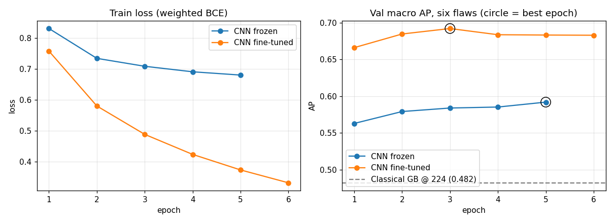

# Stage D: CNN (Arm 2)

Partitions: train and val only. The test partition is not read during development.

## Environment

- Python 3.13.16 on Linux-6.6.122+-x86_64-with-glibc2.39
- RAM: 12.7 GB
- GPU: none (not needed here: this notebook scores saved predictions; the training GPU is under Training runs)
- Libraries: numpy 2.1.3, pandas 2.2.3, scikit-learn 1.6.1, torch 2.11.0+cpu, torchvision 0.26.0+cpu
- Seed: 42 (training seeded torch/numpy/random with 42, reseeded 42 + epoch every epoch)

## Findings (hypothesis check)

<!-- findings:start -->
_Findings not yet written._
<!-- findings:end -->

## Data

Val 3,875 images, scored by every arm. Positives per output at >=2 votes:

| index | val positives | base rate |
|---|---|---|
| BLR | 1636 | 0.422 |
| BRT | 224 | 0.058 |
| DRK | 244 | 0.063 |
| FRM | 2148 | 0.554 |
| OBS | 137 | 0.035 |
| ROT | 664 | 0.171 |
| UNREC | 606 | 0.156 |

## Training runs

`scripts/train_cnn.py`: efficientnet_b0 IMAGENET1K_V1, batch 64, AdamW (default weight decay), BCE with pos_weight = negatives/positives on train, mixed precision, constant learning rates, early stop after 3 epochs without improvement in val macro AP (six flaws), seed 42.

| index | data | trains | lr heads / backbone | max epochs | epochs run | best epoch | s per epoch | result |
|---|---|---|---|---|---|---|---|---|
| overfit | 200 fixed train images, no flip | whole network | 0.001 / 0.0001 | 100 | 38 | - | 1 | PASS: fit loss 0.0467 (target < 0.05) |
| frozen | full train, horizontal flip | heads only | 0.001 / frozen | 5 | 5 | 5 | 52 | best val macro AP 0.5920 |
| finetune | full train, horizontal flip | whole network | 0.001 / 0.0001 | 15 | 6 | 3 | 74 | best val macro AP 0.6922 |

Training environment:

| index | gpu | python | libraries |
|---|---|---|---|
| overfit | Tesla T4 | 3.13.15 | numpy 2.1.3, pandas 2.2.3, scikit-learn 1.6.1, torch 2.11.0+cu130, torchvision 0.26.0+cu130 |
| frozen | Tesla T4 | 3.13.15 | numpy 2.1.3, pandas 2.2.3, scikit-learn 1.6.1, torch 2.11.0+cu130, torchvision 0.26.0+cu130 |
| finetune | Tesla T4 | 3.13.15 | numpy 2.1.3, pandas 2.2.3, scikit-learn 1.6.1, torch 2.11.0+cu130, torchvision 0.26.0+cu130 |

## Training curves

Fine-tune, per epoch (val AP):

| epoch | train loss | val macro AP | BLR | BRT | DRK | FRM | OBS | ROT | UNREC |
|---|---|---|---|---|---|---|---|---|---|
| 1 | 0.757 | 0.666 | 0.868 | 0.562 | 0.584 | 0.783 | 0.545 | 0.654 | 0.791 |
| 2 | 0.58 | 0.685 | 0.884 | 0.573 | 0.596 | 0.816 | 0.558 | 0.681 | 0.799 |
| 3 | 0.488 | 0.692 | 0.885 | 0.564 | 0.623 | 0.823 | 0.563 | 0.696 | 0.802 |
| 4 | 0.424 | 0.684 | 0.881 | 0.526 | 0.623 | 0.823 | 0.555 | 0.694 | 0.792 |
| 5 | 0.374 | 0.683 | 0.887 | 0.537 | 0.609 | 0.832 | 0.534 | 0.7 | 0.788 |
| 6 | 0.332 | 0.683 | 0.887 | 0.512 | 0.615 | 0.832 | 0.543 | 0.709 | 0.781 |

## Full table: CNN fine-tuned

| index | n | positives | base rate | AP | gain | precision | recall | F1 |
|---|---|---|---|---|---|---|---|---|
| BLR | 3875 | 1636 | 0.422 | 0.885 | 0.8 | 0.828 | 0.76 | 0.792 |
| BRT | 3875 | 224 | 0.058 | 0.564 | 0.537 | 0.277 | 0.79 | 0.41 |
| DRK | 3875 | 244 | 0.063 | 0.623 | 0.597 | 0.268 | 0.832 | 0.406 |
| FRM | 3875 | 2148 | 0.554 | 0.823 | 0.603 | 0.778 | 0.741 | 0.759 |
| OBS | 3875 | 137 | 0.035 | 0.563 | 0.547 | 0.178 | 0.781 | 0.29 |
| ROT | 3875 | 664 | 0.171 | 0.696 | 0.633 | 0.524 | 0.795 | 0.632 |
| UNREC | 3875 | 606 | 0.156 | 0.802 | 0.765 | 0.523 | 0.83 | 0.642 |
| macro (6 flaws) | <NA> | <NA> | 0.217 | 0.692 | nan | 0.475 | 0.783 | 0.548 |

## Full table: CNN frozen

| index | n | positives | base rate | AP | gain | precision | recall | F1 |
|---|---|---|---|---|---|---|---|---|
| BLR | 3875 | 1636 | 0.422 | 0.809 | 0.669 | 0.714 | 0.731 | 0.722 |
| BRT | 3875 | 224 | 0.058 | 0.412 | 0.376 | 0.183 | 0.79 | 0.297 |
| DRK | 3875 | 244 | 0.063 | 0.545 | 0.514 | 0.216 | 0.803 | 0.34 |
| FRM | 3875 | 2148 | 0.554 | 0.795 | 0.54 | 0.732 | 0.77 | 0.75 |
| OBS | 3875 | 137 | 0.035 | 0.354 | 0.33 | 0.133 | 0.774 | 0.226 |
| ROT | 3875 | 664 | 0.171 | 0.637 | 0.562 | 0.425 | 0.785 | 0.551 |
| UNREC | 3875 | 606 | 0.156 | 0.775 | 0.733 | 0.554 | 0.802 | 0.655 |
| macro (6 flaws) | <NA> | <NA> | 0.217 | 0.592 | nan | 0.4 | 0.775 | 0.481 |

## CNN against the classical arm (val)

AP and gain per output; gain = (AP - base rate) / (1 - base rate).

| index | type | base rate | AP Classical GB @ 224 | AP CNN frozen | AP CNN fine-tuned | gain Classical GB @ 224 | gain CNN fine-tuned | gain difference (CNN - classical) |
|---|---|---|---|---|---|---|---|---|
| BLR | photometric | 0.422 | 0.809 | 0.809 | 0.885 | 0.669 | 0.8 | 0.132 |
| BRT | photometric | 0.058 | 0.472 | 0.412 | 0.564 | 0.44 | 0.537 | 0.097 |
| DRK | photometric | 0.063 | 0.551 | 0.545 | 0.623 | 0.521 | 0.597 | 0.077 |
| FRM | semantic | 0.554 | 0.698 | 0.795 | 0.823 | 0.322 | 0.603 | 0.281 |
| OBS | semantic | 0.035 | 0.126 | 0.354 | 0.563 | 0.094 | 0.547 | 0.453 |
| ROT | semantic | 0.171 | 0.238 | 0.637 | 0.696 | 0.08 | 0.633 | 0.553 |
| UNREC | recognisability | 0.156 | 0.73 | 0.775 | 0.802 | 0.68 | 0.765 | 0.085 |
| macro (6 flaws) |  | 0.217 | 0.482 | 0.592 | 0.692 | nan | nan | nan |

Mean gain by flaw type:

| type | gain Classical GB @ 224 | gain CNN fine-tuned | gain difference (CNN - classical) |
|---|---|---|---|
| photometric | 0.543 | 0.645 | 0.102 |
| semantic | 0.165 | 0.594 | 0.429 |

F1 at threshold 0.5:

| index | Classical GB @ 224 | CNN frozen | CNN fine-tuned |
|---|---|---|---|
| BLR | 0.728 | 0.722 | 0.792 |
| BRT | 0.359 | 0.297 | 0.41 |
| DRK | 0.362 | 0.34 | 0.406 |
| FRM | 0.658 | 0.75 | 0.759 |
| OBS | 0.146 | 0.226 | 0.29 |
| ROT | 0.329 | 0.551 | 0.632 |
| UNREC | 0.61 | 0.655 | 0.642 |
| macro (6 flaws) | 0.43 | 0.481 | 0.548 |

## ROT: content or shape? (val)

Geometry-only cues scored as ROT predictors on val:

| index | n | cue on % | ROT prevalence % | AP | ROT % \| cue on | ROT % \| cue off |
|---|---|---|---|---|---|---|
| landscape-shaped pixels (all images) | 3875 | 6.8 | 17.1 | 0.254 | 54.9 | 14.4 |
| EXIF orientation 6 (all images) | 3875 | 6.1 | 17.1 | 0.267 | 60.9 | 14.3 |
| landscape-shaped pixels (orientation 1 only) | 3637 | 0.7 | 14.3 | 0.143 | 0 | 14.4 |

ROT AP by EXIF orientation:

| index | AP, all (n=3875, base 0.171) | AP, orientation 1 (n=3637, base 0.143) | gain, orientation 1 | AP, orientation 6 (n=238, base 0.609) | gain, orientation 6 |
|---|---|---|---|---|---|
| Classical GB @ 224 | 0.238 | 0.197 | 0.064 | 0.747 | 0.353 |
| CNN frozen | 0.637 | 0.581 | 0.512 | 0.859 | 0.638 |
| CNN fine-tuned | 0.696 | 0.62 | 0.557 | 0.891 | 0.722 |

## BLR by native resolution (val)

| index | native < 512 (n=361, base 0.427) | native >= 512 (n=3514, base 0.422) |
|---|---|---|
| Classical GB @ 224 | 0.759 | 0.813 |
| CNN frozen | 0.8 | 0.811 |
| CNN fine-tuned | 0.872 | 0.887 |

## Single-flaw check (val)

| index | n | positives (flaw alone) | base rate | AP Classical GB @ 224 | AP CNN frozen | AP CNN fine-tuned | gain Classical GB @ 224 | gain CNN fine-tuned |
|---|---|---|---|---|---|---|---|---|
| BLR | 1254 | 402 | 0.321 | 0.729 | 0.73 | 0.845 | 0.6 | 0.772 |
| BRT | 876 | 24 | 0.027 | 0.447 | 0.305 | 0.464 | 0.431 | 0.449 |
| DRK | 910 | 58 | 0.064 | 0.81 | 0.767 | 0.858 | 0.797 | 0.849 |
| FRM | 1644 | 792 | 0.482 | 0.626 | 0.764 | 0.793 | 0.278 | 0.6 |
| OBS | 869 | 17 | 0.02 | 0.115 | 0.49 | 0.697 | 0.097 | 0.691 |
| ROT | 1011 | 159 | 0.157 | 0.194 | 0.611 | 0.701 | 0.044 | 0.645 |
